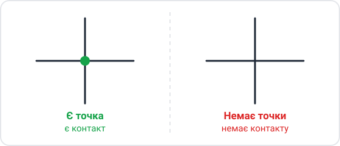
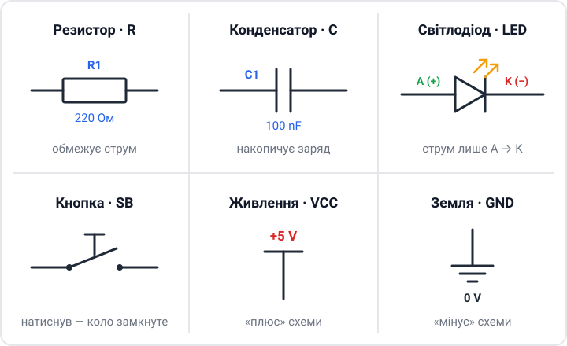
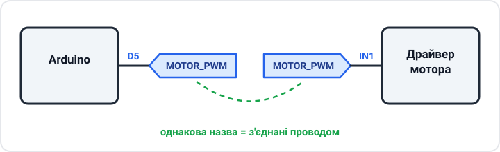
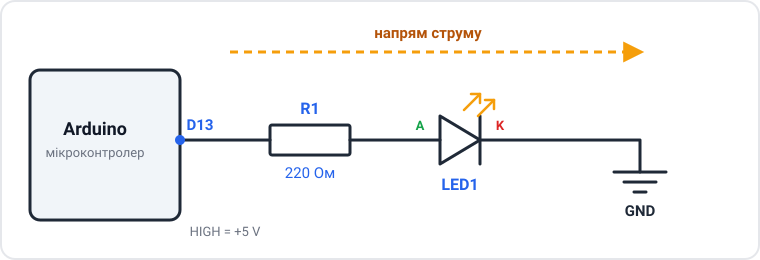

# 📒 Конспект: Як читати електричні схеми

**Предмет:** Робототехніка  **Клас:** 7–8  **Дата:** ____________

> 💡 **Головна думка:** схема — це **карта з'єднань**. Вона показує не те, як деталі *виглядають*, а те, **що з чим з'єднано**.

---

## 1. Із чого складається схема

| Що бачу на схемі | Що це означає | Приклад |
|---|---|---|
| **Символ (УГО)** | деталь | резистор, світлодіод, Arduino |
| **Лінія** | провід або доріжка на платі | — |
| **Точка на перетині** | з'єднання (вузол) | див. малюнок ↓ |
| **Позначення + номінал** | тип і номер деталі, її «розмір» | `R1` · 220 Ом, `C2` · 100 nF |

> ⚠️ **Запам'ятати:** немає точки — **немає контакту**, навіть якщо лінії перетинаються.

---

## 2. Абетка символів

**Букви-позначення:** `R` — резистор · `C` — конденсатор · `LED` (або `VD`) — світлодіод · `SB` — кнопка · `VCC` — плюс · `GND` — мінус (земля).

> 📝 **Моя примітка:** в англійських програмах (Tinkercad, Fritzing) резистор малюють **зигзагом** ⩘⩘⩘. Це той самий резистор!

---

## 3. Правила читання

1. ➡️ Читаю **зліва направо** — від входу до виходу.
2. ⬇️ Читаю **згори вниз** — від `VCC` (+) до `GND` (0 В).
3. 🏷️ **Мітки (Net Names):** однакові назви біля ніжок = **вони з'єднані**, хоча лінії не намальовано.
4. Усі `GND` на схемі — **один провід**.

---

## 4. Приклад: світлодіод на піні D13

**Шлях струму (коротко стрілками):**

> `D13` → `R1` (220 Ом) → **A** `LED1` **K** → `GND`

- `D13` = HIGH (+5 В) → струм іде → світлодіод **світиться** 💡
- `D13` = LOW (0 В) → струму немає → світлодіод **не світиться**

❓ **Навіщо `R1`?** Щоб **обмежити струм**. Без нього згорить світлодіод або пін Arduino 🔥

➕ Для допитливих: рахуємо струм (закон Ома)

На червоному світлодіоді «губиться» ≈ 2 В, отже на резисторі залишається 5 − 2 = 3 В.

$$I = \frac{U}{R} = \frac{3\ \text{В}}{220\ \text{Ом}} \approx 0{,}014\ \text{А} = 14\ \text{мА}$$

Це безпечно і для світлодіода (≈ 20 мА максимум), і для піна Arduino.

---

## 5. Алгоритм розбору будь-якої схеми

Підказка, щоб запам'ятати: **Ж – М – Б – С**

| Крок | Що роблю |
|:-:|---|
| **Ж**ивлення | знаходжу `VCC` і `GND` |
| **М**озок | знаходжу мікроконтролер, дивлюся, які піни задіяні |
| **Б**локи | ділю схему на частини: живлення, датчики, мотори, індикація |
| **С**игнали | простежую шлях: датчик → мікроконтролер → мотор / світлодіод |

---

## ✅ Перевір себе

1. Чим відрізняється перетин ліній з точкою від перетину без точки?
2. Що означає, якщо біля двох різних ніжок написано `MOTOR_PWM`?
3. В якому напрямку читають схему?
4. Що станеться, якщо прибрати `R1` зі схеми зі світлодіодом?

Відповіді

1. З точкою — дроти з'єднані; без точки — просто перетинаються на папері.
2. Ці ніжки з'єднані між собою, хоча лінію не намальовано.
3. Зліва направо і згори (`VCC`) вниз (`GND`).
4. Струм стане завеликим — світлодіод або пін мікроконтролера можуть згоріти.

---

## 🛠️ Як зроблено цей конспект (поради)

- **Одна головна думка** на початку — щоб одразу було зрозуміло, про що тема.
- **Таблиці** замість довгих речень, коли треба порівняти або перелічити.
- **Стрілки** `→` замість слів «потім», «далі», «йде до».
- **Жирним** — лише ключові слова, а не цілі речення.
- **Свої малюнки** — символ запам'ятовується краще, коли його намалював сам.
- **Мнемоніка** (Ж–М–Б–С) — щоб легко пригадати алгоритм.
- **Питання для самоперевірки** в кінці — щоб повторити тему перед уроком.
